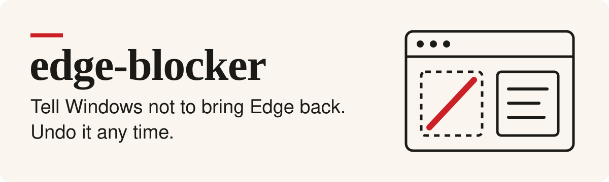
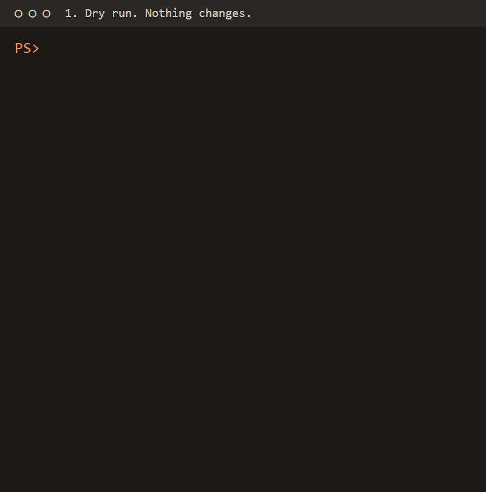

<picture>
  <source media="(prefers-color-scheme: dark)" srcset="assets/banner-dark.svg">
  
</picture>

[](https://github.com/zed-dz/edge-blocker/actions/workflows/ci.yml)

**Tell Windows not to bring Microsoft Edge back. WebView2 keeps working, and one command undoes it.**



The demo is the real scripts, run on a pretend registry.

> [!IMPORTANT]
> Microsoft says its Edge install and update policies work [only on PCs joined to a company domain](https://learn.microsoft.com/en-us/deployedge/microsoft-edge-update-policies). On a home PC Windows may ignore some of these values. My own home PC has them set and has no Edge today, 25 November 2026. That is one PC, not proof. Read [Limits](#limits) first.

## Who it is for

- You removed Edge from Windows 10 or 11 and want it to stay removed.
- You need WebView2, because other apps draw their windows with it.
- You want to see every change before it happens, and to undo it.

## Install

1. Right-click **Start** and choose **Terminal (Admin)**.
2. Paste this. It downloads the scripts and shows what would change. Nothing changes yet.

```powershell
cd $env:USERPROFILE\Downloads
irm https://github.com/zed-dz/edge-blocker/releases/latest/download/edge-blocker.zip -OutFile edge-blocker.zip
Expand-Archive edge-blocker.zip edge-blocker -Force
cd edge-blocker
powershell -ExecutionPolicy Bypass -File .\edge-block.ps1 -WhatIf
```

3. Apply it:

```powershell
powershell -ExecutionPolicy Bypass -File .\edge-block.ps1
```

4. Undo it, any time:

```powershell
powershell -ExecutionPolicy Bypass -File .\edge-unblock.ps1
```

## What it does

Under `HKLM\SOFTWARE\Policies\Microsoft\EdgeUpdate`:

| Value | Set to | Meaning |
|---|---|---|
| `Install` and `Update` for Edge Stable, Beta, Dev, Canary | `0` | Do not install or update these channels |
| `Install` and `Update` for WebView2 | `1` | WebView2 may install and update |
| `CreateDesktopShortcutDefault` | `0` | No Edge desktop shortcut |

Under `HKLM\SOFTWARE\Microsoft\EdgeUpdate`:

| Value | Set to | Meaning |
|---|---|---|
| `DoNotUpdateToEdgeWithChromium` | `1` | Asks Windows Update not to deliver Edge. Microsoft made it for Windows 10 in 2020. |

It sets the `MicrosoftEdgeElevationService` service to **Disabled**.

It does not uninstall Edge, delete files or patch system files. Remove Edge first in Settings > Apps, if your Windows lets you.

| Option | What it does |
|---|---|
| `-WhatIf` or `-DryRun` | Show the changes and change nothing. Add `-Verbose` for the exact registry value behind each line. |
| `-KeepService` | Leave the service alone. |
| `-BlockUpdatesToo` | Block updates even if Edge is still installed. See below. |

## Safety and privacy

- **Edge still installed? Its updates stay on.** A browser without security fixes is a risk. Only `-BlockUpdatesToo` changes that.
- **Old values are saved first**, in `C:\ProgramData\EdgeBlocker\backup.json`. Undo gives back each old value and its type, removes what was not there before, and restores the service.
- **Undo does not trust that file.** It only ever touches the values in the tables above. A changed or planted file cannot make it write anything else.
- **The dry run is tested, not promised.** A test proves that every command that changes something sits behind one gate, and that the gate closes in a dry run.
- **Running it twice is safe.** The first backup is kept.
- **No network.** The scripts do not go online. Read them before you run them as administrator.

Run the tests. They change nothing on your PC:

```powershell
powershell -ExecutionPolicy Bypass -File tests\run.ps1
```

33 checks run on a pretend PC. On GitHub's throwaway machines they also run for real, and compare the registry before and after the undo.

## How it compares

I read these projects' own pages on 25 November 2026.

| | edge-blocker | [Remove-MS-Edge](https://github.com/ShadowWhisperer/Remove-MS-Edge) | [RemoveEdge](https://github.com/mrhaydendp/RemoveEdge) | [disable-edge-updates](https://github.com/Vikindor/disable-edge-updates) |
|---|---|---|---|---|
| Uninstalls Edge | no | yes | yes | no |
| Keeps WebView2 updating | yes | your choice | not stated | no, it turns that off too |
| Undo script | yes, exact old values | reinstall links | not stated | yes |
| Dry run | yes | not stated | not stated | not stated |
| How it blocks | policy values | uninstalls | uninstalls, "won't come back" | policies, services, tasks, folder locks |

Need Edge gone right now? Use Remove-MS-Edge. Then run edge-blocker to ask Windows not to bring it back. If you want a harder block and do not need WebView2 updates, look at disable-edge-updates.

## Limits

- **Home PCs.** Microsoft documents the `Install` and `Update` values for domain-joined PCs only. On other PCs the updater may ignore them.
- **Big Windows upgrades** may put Edge back. I have not tested that.
- **`DoNotUpdateToEdgeWithChromium`** comes from Microsoft's 2020 blocker for Windows 10. I found no Microsoft statement that Windows 11 respects it.
- **It does not block you.** You can still install Edge by hand from Microsoft.
- Company PCs managed with Group Policy or Intune may write over these values.
- Not tested on ARM PCs or Windows S mode.

If Edge came back on your PC, [open an issue](https://github.com/zed-dz/edge-blocker/issues/new/choose) with your Windows version. That is the most useful thing you can send me.

## Contributing

Read [CONTRIBUTING.md](CONTRIBUTING.md). For a security problem, see [SECURITY.md](SECURITY.md).

## Licence

[MIT](LICENSE). Not made or approved by Microsoft. Made by Amine Hammou. More tools: https://aminehammou.vercel.app/tools.html
